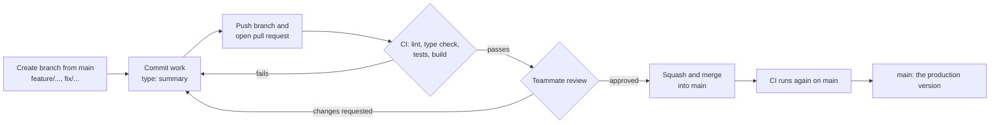

# Git Workflow

How our team moves code from an idea to `main`. Every change, however small, follows these steps, and GitHub enforces the important ones for us.

## Branching strategy

`main` is our only long-lived branch. It is protected and always passes CI, so it is always safe to demo.

All work happens on short-lived branches:

1. Pull the latest `main`.
2. Create a branch from it for one task.
3. Commit the work there.
4. Merge it back into `main` through a pull request.
5. The branch is deleted after merging.

## Branch naming

Branches are named `type/short-name`, in lowercase with words separated by hyphens.

| Type | Use for | Example |
| --- | --- | --- |
| `feature` | New functionality | `feature/membership-status-card` |
| `fix` | Bug fixes | `fix/login-error-message` |
| `docs` | Documentation only | `docs/git-workflow` |
| `test` | Adding or fixing tests only | `test/signup-edge-cases` |
| `ci` | Pipeline and tooling | `ci/github-actions` |
| `refactor` | Restructuring with no change in behavior | `refactor/auth-session` |
| `chore` | Dependencies and housekeeping | `chore/update-lockfile` |

## Commit message format

We use [Conventional Commits](https://www.conventionalcommits.org/): `type: short summary`.

- The type is one of the branch types above, with `feat` for features.
- The summary is imperative ("add", not "added"), lowercase, with no period, and at most 72 characters.
- An optional body after a blank line explains why the change was made.

Examples:

```
feat: show membership status on member home
```

```
fix: sync package-lock.json so npm ci works in CI

npm ci failed in GitHub Actions because the lockfile was missing an
entry that package.json needed.
```

## Pull request process

1. Push the branch and open a pull request into `main`.
2. Fill in the pull request template: summary, changes, how to test, and notes.
3. Request a review from at least one teammate who is not the author.
4. CI runs automatically. Its **Lint, test and build** check must be green.
5. The reviewer reads the changes, runs the tests if useful, and leaves comments.
6. The author answers or fixes every comment and pushes. Pushing new commits clears earlier approvals, so the reviewer approves again.
7. When CI is green, at least one teammate has approved, and every conversation is resolved, the author merges.

## Merge policy

- **Squash and merge only.** Each pull request becomes a single commit on `main`, whose message is the pull request title. That's why pull request titles follow the commit message format too.
- **Branches are deleted after merging.**
- **Nobody pushes directly to `main`**, including the repository owner.

## Branch protection rules on main

These rules are set in a GitHub ruleset ("Protect Main"), so GitHub enforces them rather than relying on us to remember.

| Rule | Setting |
| --- | --- |
| Pull request required before merging | On |
| Approvals required | 1 |
| Dismiss stale approvals when new commits are pushed | On |
| Required status check | Lint, test and build |
| Branch must be up to date with `main` before merging | On |
| All conversations resolved before merging | On |
| Allowed merge method | Squash only |
| Bypassing the rules | Not allowed |
| Force pushes | Blocked |
| Deleting `main` | Blocked |

## CI pipeline

Defined in `.github/workflows/ci.yml`. It runs on every pull request to `main` and on every push to `main`, on Node.js 24:

| Step | Command |
| --- | --- |
| Install exactly the locked dependencies | `npm ci` |
| Lint | `npm run lint` |
| Type check | `npx tsc --noEmit` |
| Unit and integration tests with coverage | `npm run test:coverage` |
| Production build | `npm run build` |

The result appears on the pull request as the **Lint, test and build** check. The coverage report is uploaded as a downloadable artifact on each run.

## Workflow diagram


